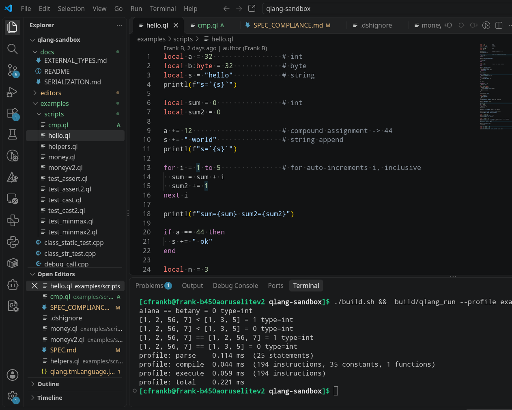
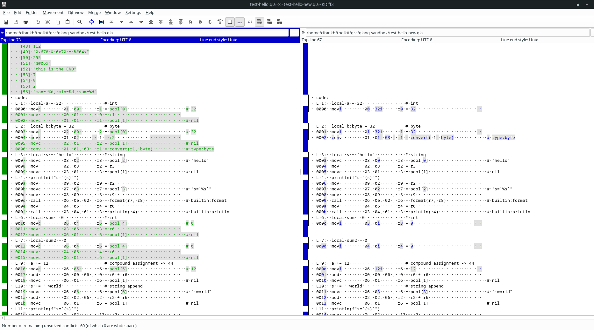

# QLang (codename)

A small, embeddable scripting language: a C++ toolchain that lexes, parses,
compiles to a register-machine bytecode, and runs it in a stack-of-frames VM.
Built to be embedded in an engine — a `QLangContext` owns the script scope,
injects native functions, and hands script results back to the host.

```
       ARCHITECTURAL TOPOLOGY

   +------------------------------------+
   |  hitbox editor, tile editor        |
   |  map editor and other tools        |  <-- The Spatial UI Tools (Qt 6)
   +------------------------------------+
                     │
                     ▼ (Generates Assets & Logic Scripts)
   +------------------------------------+
   |     C++ Runtime / Engine           |  <-- The Core Execution Engine (SDL3)
   |  ┌──────────────────────────────┐  |
   |  │         qlang client         │  |  <-- Embedded Sandbox VM Context
   |  └──────────────────────────────┘  |
   +------------------------------------+
```


**Stage:** POC. The language core (values, control flow, functions, closures,
generators, tables, sets, enums, classes, modules, native interop, external
types) is implemented and test-covered; `.qlc` bytecode is written and read
back through the library codec. The design docs (serialization, external
types, event handlers) describe the implemented surface; the remaining gaps
are the `$$` indirect operator and the warning-toggle infrastructure (see
`docs/compliance/README.md`).



byte code encoding



## Layout

```
include/qlang/   Public API headers
src/             Library implementation (libqlang.a)
examples/        qlcc driver, demos, and per-feature test suites
docs/            spec/ (18 modules), compliance/, plans/, design docs
SPEC.md          Stub — spec migrated to docs/spec/ (authoritative)
SPEC_COMPLIANCE.md  Stub — tracker migrated to docs/compliance/ (SHA256-gated)
```

## Components

| Component | Header | Role |
|-----------|--------|------|
| `QLangLexer` | `QLangLexer.h` | Tokenizes source text |
| `QLangParser` | `QLangParser.h` | Builds the AST |
| `QLangCompiler` | `QLangCompiler.h` | Lowers the AST to register-machine bytecode (`CompiledProgram`) |
| `QLangVM` | `QLangVM.h` | Executes a `CompiledProgram` (stack of frames, register file) |
| `QLangBytecode` | `QLangBytecode.h` | `Opcode` set, `Bytecode` / `Function` / `ProgramImage` |
| `QLangValue` | `QLangValue.h` | Runtime value (typed, tag-based) |
| `QLangContext` | `QLangContext.h` | Host: scope, native functions, modules, step guard, trace level |
| `QLangModules` | `QLangModules.h` | Built-in modules (e.g. `math`) |
| `QLangErrors` | `QLangErrors.h` | Structured `QLangError` |

## Build

Requires CMake 3.16+.

```bash
cmake -B build
cmake --build build
ctest --test-dir build
```

Targets: `qlang` (library → `libqlang.a`), `qlang_example` (hello),
`qlcc` (driver), plus one executable per test suite. A single suite can
also be built and run directly against `build/libqlang.a` with g++ (C++20);
see `AGENTS.md` for the exact harness.

C++20 throughout. Three CI gates cover the toolchains: `ci.yml` (native g++,
clang++, and a mingw-w64 Windows cross-compile), `ci-msvc.yml` (MSVC x64 on
`windows-latest`), and `ci-wasm.yml` (emscripten). The declarative-meta header's
portability across these is tracked in `docs/COMPILER_PORTABILITY.md`.

## Usage

```cpp
#include <qlang/QLangContext.h>
#include <qlang/QLangValue.h>

using namespace qlang;

QLangContext ctx;

// Inject a native callable from QLang:  log(x)
ctx.setFunc("log", [](QLangContext &, const std::vector<QLangValue> &args) {
  // args[0] ... ; return a QLangValue (nil if no result)
  return QLangValue::String("ok");
});

// Parse + compile + run; final variable state is written back to the scope.
ctx.run(R"(
  x = 6 * 7
  log(x)
)");

QLangValue v = ctx.get("x");   // 42
```

`ctx.parse(source)` returns the raw AST (`std::vector<StmtPtr>`); `ctx.run`
is the compile-and-execute shortcut. `ctx.call(name, args)` invokes a QLang or
native function by name. `ctx.registerModule` / `ctx.importModule` expose
named native function groups to `import`.

## Value types

| Type | C++ | Notes |
|------|-----|-------|
| `nil` | — | unset / absent |
| `bool` | `bool` | stored as Int 1/0 at runtime |
| `char` | `int8_t` | signed; distinct from `Byte` |
| `byte` | `uint8_t` | |
| `Word` | `uint16_t` | |
| `short` | `int16_t` | |
| `int` | `int32_t` | |
| `unsigned` | `uint32_t` | |
| `qword` | `uint64_t` | |
| `dword` | `uint32_t` | alias for `unsigned` |
| `long` | `int64_t` | |
| `string` | null-terminated text | |
| `blob` | binary data | |
| `array` | list of mixed values | |
| `float` | `double` | |
| `table` | string → value map | |
| `set` | array of unique values | numbers and strings only |
| `function` | closure | `def` / arrow, with captures |
| `generator` | yield-based closure | lazy, resumable |
| `eof` | sentinel | end-of-file marker |

## Implemented features

- Control flow: `if`/`elif`/`else`, `for`, `while`, `switch`, `break`,
  `continue`, `return`, labels
- Functions: `def` and arrow closures with explicit capture lists; nested
  calls; generator functions (`yield`)
- Collections: arrays, tables (keyed maps), and sets (unique numbers/strings);
  runtime type tracking drives `+=` (append vs. add) and index/member access
- Classes: closed fields, `const` fields, `__str__`, `__destroy__`, reference
  counting; `static` members and `::` scope resolution (extension beyond v1)
- Enums: compile-time constant tables (`enum Name[:type] { … }`, `E::M`)
- External types: import C++ objects (`QL_` declarative meta), method
  dispatch, read-only properties, enum constants
- Bytecode: `.qlc` program-image codec (write + read back, `QLC1` v9)
- Portable modules: `.qpm` packages (`QPM1`) bundle the linked entry image with a
  `QL_OBJECT` type manifest (`.qlm`, `QLM1`); `qlcc --run file.qpm` loads one, and
  its manifest is validated against the host's registered types
- Const vars (`const`) with reassignment guards
- Native interop: inject C++ functions (`setFunc`), call script functions
  from C++ (`call`), modules (`import`, built-in `math`)
- Safety: live infinite-loop step guard (`set_max_steps`, default 100 000)
- Diagnostics: line+column error reports with module, function, and execution
  trace; gated trace tiers (`set_verbose_level`, 0–3) — never touches program
  output; one universal output callback (`setOutputCallback`) routes every
  message — program output and trace alike — into a single host sink
  (`examples/output_callback.cpp`)

**Spec'd, not yet built:** the `$$` indirect operator (fully specified in
`docs/spec/05-operators.md`), the duplicate-declaration warning (deferred
pending the warning-toggle infrastructure), and the `.qls` state-snapshot
format (`QLS1` v2, `docs/SERIALIZATION.md`). See `docs/compliance/README.md`
for the full open-items list.

## Driver

`qlcc [options] <file.ql|file.qlc|file.qpm> [library ...]` compiles a script, a
compiled image, or a portable package; the program executes only with `--run`
(loads one with `qlcc --run file.qpm`). The contract is
`docs/spec/18-qlang-run.md`. Three modes are not "run": `--qlmeta-dump` writes
this binary's `QL_OBJECT` types as a `.qlm` manifest, `--qlmeta` compiles a `.ql`
entry against one, and `--package` writes a `.qpm`. The short flags combine
(`-ca` = `-c -a`, `-car` = `-c -a -r`). Flags:

| Flag | Effect |
|------|--------|
| `--trace-level <0-3>` | Diagnostic verbosity on stderr (0 = off, 3 = full detail) |
| `--profile` | Report parse / compile / execute times in ms |
| `--run` | Execute the program; without it `qlcc` only compiles |
| `--strict <0-2>` | Strict-typing level (SPEC `docs/spec/16-strict_typing.md`): 0 off, 1 check declared, 2 enforce; applied to the context |
| `-c` | Save the compiled entry image as `<stem>.qlc` |
| `-a` | Save a disassembly listing as `<stem>.qla` (with `-c` at once: `-ca`) |
| `--asm-level <0-5>` | Disassembly detail (0 = instructions, 5 = register breakdown) |
| `--output-path <dir>` | Directory the `-c`/`-a` artifacts go to (created when missing); defaults to the entry file's own directory |
| `-r`, `--rotate` | Append a timestamp to the `-c`/`-a` names (`cmp.qlc` → `cmp_202611010513.qlc`) |
| `--module-path <dir>` | Add a directory `import <name>` resolves against (repeatable) |
| `--no-module-search` | Resolve `import` only against C++ modules and images named on this command line |
| `--import <lib>` | Load one module explicitly (a name, a directory, or a `.ql`/`.qlc` path) |
| `--qlmeta-dump <file.qlm>` | Write this binary's registered `QL_OBJECT` types as a `QLM1` type manifest |
| `--qlmeta <file.qlm>` | Compile the `.ql` entry against a `QLM1` manifest (external-type contract; checks only) |
| `--package <file.qpm>` | Write a `QPM1` portable module (entry image + linked modules + manifest); load it with `qlcc --run file.qpm` |

Artifacts are named, not specified: `-c` and `-a` write `<entry stem>.qlc` and
`<entry stem>.qla`. A module argument (`--import` or a positional library) is
reused from its `.qlc` only when that image exists, carries this build's `.qlc`
version and is not older than its `.ql`; otherwise the `.ql` is compiled, the
image saved beside the source (never rotated) and then loaded. `-a` also lists
every image generated that way.

Exit codes 0–5 (completion → write failures) are documented in `--help`.

## Design docs

| Doc | Covers |
|-----|--------|
| `docs/spec/README.md` | The language itself — 18 modules, authoritative |
| `docs/compliance/README.md` | Spec ↔ implementation tracker (SHA256-gated) |
| `docs/SERIALIZATION.md` | `.qlc` (bytecode), `.qls` (state snapshot), `.qlm` (type manifest), `.qpm` (portable module) formats, step counter |
| `docs/EXTERNAL_TYPES.md` | C++ object import: the `ObjectOps` dispatch surface, ownership model |
| `docs/EVENT_HANDLERS.md` | **Engine-specifics:** how the engine drives QLang as event handlers |
| `docs/COMPILER_PORTABILITY.md` | Portability of the declarative-meta header (`QLangMeta.h`) across g++, Clang, MinGW, MSVC, emscripten/WASM |

The C++ API (object dispatch, step counter, ownership model, error boundary)
is part of **QLang**; the multi-level event-handler architecture and its
budget/retention/re-entrancy policies are **engine-specifics** built on that
API (`docs/EVENT_HANDLERS.md` §0). Adding a handler level needs no QLang
change — only engine wiring.


## Next steps

- `$$` indirect operator (fully specified in `docs/spec/05-operators.md`)
- Warning-toggle infrastructure + duplicate-declaration warning
- `.qls` state-snapshot loader (`QLS1` v2, `docs/SERIALIZATION.md`)
- Wire the event-handler contract into the engine (`docs/EVENT_HANDLERS.md`)
